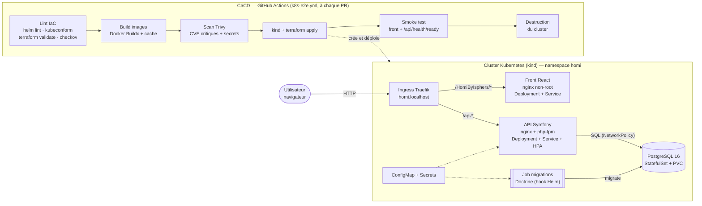

# Homi

[](https://github.com/lahatraR/HomiByIsphers/actions/workflows/k8s-e2e.yml)
[](https://github.com/lahatraR/HomiByIsphers/actions/workflows/backend-ci.yml)
[](https://github.com/lahatraR/HomiByIsphers/actions/workflows/frontend-ci.yml)
[](https://github.com/lahatraR/HomiByIsphers/actions/workflows/deploy.yml)
[](https://github.com/lahatraR/HomiByIsphers/actions/workflows/send-pending-emails.yml)

**Homi est un SaaS de gestion de domiciles en production** : un propriétaire gère ses biens, y affecte des intervenants, suit les tâches et le temps passé, puis génère factures et budgets.
Stack : **React 19 / TypeScript** (Vite), **Symfony 8 / PHP 8.4** (API REST + JWT), **PostgreSQL 16**, déployée sur **Kubernetes** avec **Terraform** et **Helm**.

---

## Architecture



| Composant | Rôle | Points clés |
|---|---|---|
| `infra/terraform/` | Crée le cluster kind, installe Traefik, metrics-server et l'application | Providers figés (`tehcyx/kind`, `hashicorp/helm`, `hashicorp/random`), secrets générés, variables documentées |
| `infra/helm/homi/` | Chart de l'application | Probes, requests/limits, HPA, NetworkPolicies, `values.schema.json`, aucun secret en clair |
| `infra/scripts/smoke-test.sh` | Test HTTP de bout en bout via l'ingress | Partagé entre `make test` et la CI |
| `Makefile` | Point d'entrée unique | `up`, `down`, `test`, `logs` (+ `lint`, `smoke`, `status`) |

---

## Démarrage en 3 commandes

Prérequis : Docker, [kind](https://kind.sigs.k8s.io/), kubectl, Helm et Terraform (≥ 1.6). Pour `make lint`, il faut aussi [kubeconform](https://github.com/yannh/kubeconform) et [checkov](https://www.checkov.io/). Sous Windows, lancer les commandes depuis Git Bash.

```bash
git clone https://github.com/lahatraR/HomiByIsphers.git && cd HomiByIsphers
make up     # build des images + cluster kind + Traefik + Homi (≈ 4 min la 1re fois)
make test   # lint de l'infra + smoke test
```

L'application est ensuite disponible sur **http://homi.localhost/HomiByIsphers/**, et l'API sur `http://homi.localhost/api/health`.

```bash
make logs   # suit les logs de tous les pods
make down   # détruit le cluster
```

> Si le port 80 est déjà pris : `make up HTTP_PORT=8080`.

---

## Les 5 pipelines CI/CD

| Workflow | Déclencheur | Ce qu'il fait |
|---|---|---|
| **[K8s E2E](.github/workflows/k8s-e2e.yml)** *(nouveau)* | Chaque PR, push sur `main` | **Lint IaC** : `helm lint`, `kubeconform`, `terraform fmt/validate`, checkov.<br>**Build** des deux images avec cache.<br>**Scan Trivy** : bloquant sur les CVE critiques corrigeables et les secrets, rapport SARIF dans l'onglet Security.<br>**Cluster kind éphémère** : `terraform apply`, attente des pods, **smoke test**, puis destruction systématique. |
| **[Backend CI/CD](.github/workflows/backend-ci.yml)** | Push ou PR sur `homi_backend/**` | Validation Composer, base PostgreSQL 16 de test, migrations Doctrine, PHPUnit, puis **déploiement sur Render** par webhook (push sur `main`). |
| **[Frontend CI/CD](.github/workflows/frontend-ci.yml)** | Push ou PR sur `homi_frontend/**` | `npm ci`, ESLint, build TypeScript + Vite, artefact du build. |
| **[Deploy Frontend](.github/workflows/deploy.yml)** | Push sur `main` | Build de production et **publication sur GitHub Pages**. |
| **[Send Pending Emails](.github/workflows/send-pending-emails.yml)** | Cron toutes les 5 min | Appelle l'endpoint interne de l'API (authentifié par un token) qui vide la file d'e-mails en attente. |

Le pipeline K8s E2E est durci contre les attaques de chaîne d'approvisionnement :
- les actions GitHub sont **figées par SHA de commit** ;
- les binaires (kind, Trivy, kubeconform) sont **vérifiés par checksum** ;
- les permissions sont minimales (`contents: read`).

---

## Choix techniques

| Choix | Pourquoi |
|---|---|
| **kind** pour le cluster local | Un vrai Kubernetes conforme qui tourne dans Docker, identique en local et en CI, créé et détruit en moins d'une minute. |
| **Terraform pour orchestrer** kind et les charts Helm | Une seule commande décrit tout l'environnement (cluster, ingress, métriques, app), de façon déclarative et idempotente. Passer à AKS ou EKS ne change que le module « cluster ». |
| **Traefik** plutôt qu'ingress-nginx | Le projet ingress-nginx est retiré par Kubernetes depuis mars 2026 et ne reçoit plus de correctifs de sécurité. Le chart utilise une ressource `Ingress` standard, donc portable vers un autre contrôleur. |
| **PostgreSQL en StatefulSet dans le chart**, et non un chart tiers | Une identité stable et un PVC par réplica (`volumeClaimTemplates`), sans dépendance externe. En production, on viserait un service managé (Azure Database, RDS), comme le fait déjà Supabase pour Homi. |
| **Migrations dans un Job** (hook Helm `post-install`/`post-upgrade`) | Une seule exécution par déploiement, même avec plusieurs réplicas de l'API, et **un échec de migration fait échouer le déploiement**. Le script de démarrage d'origine ignorait les erreurs. |
| **Liveness ≠ readiness** | `/api/health` vérifie que le processus répond (liveness). `/api/health/ready`, ajouté pour ce chantier, vérifie l'accès à la base (readiness). Une panne de PostgreSQL retire les pods du trafic sans les redémarrer en boucle. |
| **Secrets générés par Terraform** (`random_password` + `set_sensitive`) | Aucun secret dans le dépôt. `values.example.yaml` documente les clés attendues, et le chart refuse de s'installer sans elles (`required`). |
| **NetworkPolicies** | Le front et l'API ne sont joignables que depuis l'ingress, et PostgreSQL uniquement depuis l'API et le Job de migration. C'est vérifié : un pod quelconque est bloqué. |
| **HPA + metrics-server** | L'API passe de 1 à 3 réplicas selon le CPU. Les requests et limits sont définies sur tous les conteneurs. |
| **Images sans registre**, tag = empreinte de l'image | `kind load` évite un registre local. Une image identique ne redéploie rien, une image modifiée est rechargée et déployée. |
| **Trivy bloquant sur les CVE critiques corrigeables** | Le pipeline est strict sur ce qui est actionnable. Les risques acceptés sont listés dans [`.trivyignore.yaml`](.trivyignore.yaml), **chacun justifié et avec une date d'expiration**. |
| **checkov** | 329 contrôles passent sur le chart. Les exceptions sont annotées au plus près des ressources, avec leur justification (voir [`infra/.checkov.yaml`](infra/.checkov.yaml)). |

**Limites assumées**
- L'image API d'origine tourne en root : supervisord lance nginx et php-fpm. Le chart retire toutes les capabilities sauf celles nécessaires au passage sur `www-data`.
- Symfony 8.0 n'est plus maintenu, et des CVE sont acceptées temporairement en attendant la montée en 8.1.

---

## Prochaines étapes

1. **Observabilité** : kube-prometheus-stack (Prometheus, Alertmanager, Grafana), un exporter PHP-FPM et postgres_exporter, des tableaux de bord RED (taux, erreurs, latence) par service, et des alertes sur la readiness et la saturation de l'HPA.
2. **Déploiement cloud (AKS / EKS)** : remplacer le module kind par `azurerm_kubernetes_cluster` ou `terraform-aws-modules/eks`, stocker le state Terraform à distance avec verrouillage, utiliser une base PostgreSQL managée, un registre d'images (ACR/ECR) avec des images signées (cosign), et cert-manager avec Let's Encrypt pour le TLS.
3. **GitOps avec Argo CD** : le chart devient la source de vérité d'Argo CD, avec un environnement par branche ou dossier, une synchronisation automatique, une détection de dérive, et des rollbacks par `git revert`.
4. **Durcissement applicatif** : image API non-root avec un système de fichiers en lecture seule (FrankenPHP ou séparation nginx/php-fpm en deux conteneurs), et montée de version Symfony 8.0 → 8.1.

---

Documentation fonctionnelle et technique détaillée : [DOCUMENTATION_TECHNIQUE.md](DOCUMENTATION_TECHNIQUE.md).
